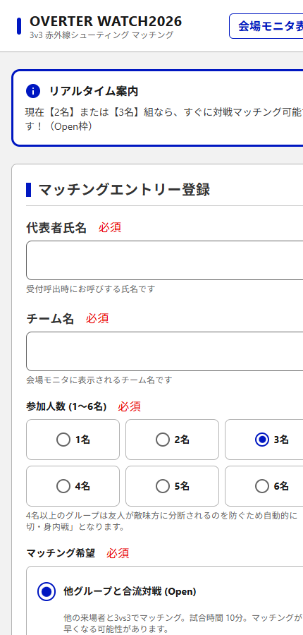
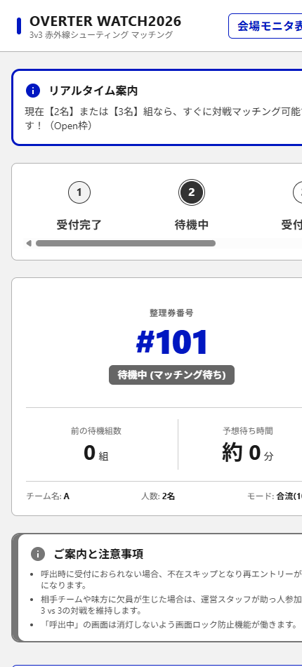
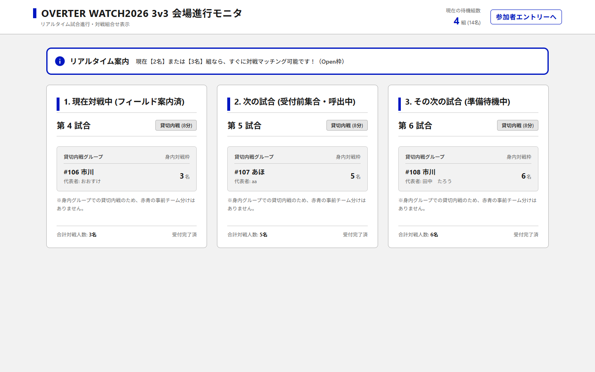
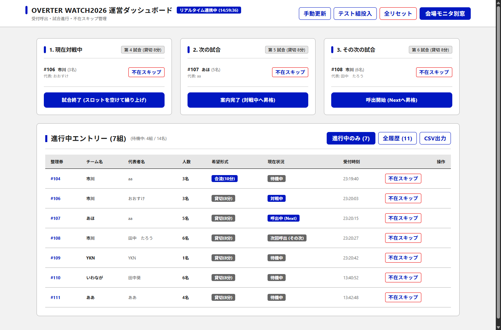

# OVERTER WATCH2026 かんたん取扱説明書

3v3 赤外線シューティングゲームのマッチングシステムです。  
**3つの画面**があり、それぞれ「受付する人」「見る人」「進行する人」用です。

---

## 🗺️ 3つの画面（これだけ覚えればOK）

| 画面 | URL | 使う人 | やること |
| :--- | :--- | :--- | :--- |
| **📱 参加者画面** | `/` | プレイヤー（スマホ） | 受付して整理券をもらう |
| **📺 会場モニタ** | `/monitor` | 観客・待機列（大画面） | いまの試合と次の試合を見る |
| **💻 運営画面** | `/admin` | スタッフ（PC・タブレット） | 試合が進んだらボタンを押す |

---

## 📱 1. 参加者（プレイヤー）の使い方

### ① スマホで受付する
QRコードからアクセスし、名前・チーム名・人数を入れて**「エントリー確定」**を押します。

> **💡 人数の安心ルール**
> - **4〜6名**: 友だち同士で戦える「貸切戦（8分）」に自動でセットされます。
> - **1〜3名**: 他のグループと合流する「合流戦（10分）」または「貸切戦」を選べます。  
> ※友だちと敵味方に引き裂かれることは絶対にありません！

---

### ② 整理券を持って待つ
受付が終わると整理券画面になります。

- **「呼出中」** になったら画面を受付スタッフに見せて入場します。
- **ブラウザを閉じても大丈夫**: もう一度開けば自動でこの画面に戻ります。

---

## 📺 2. 会場モニタ（大画面）の見方

プロジェクターや大画面TVに `/monitor` を全画面表示しておきます。

- **左枠**: 現在対戦中のチーム
- **中央枠**: 次の試合（まもなく呼出）
- **右枠**: その次の準備枠

※人数が足りない枠は「運営スタッフ（助っ人）」が自動で入るため、必ず3vs3で対戦できます。

---

## 💻 3. 運営スタッフの使い方

受付・進行席のPCで `/admin` を開きます。

### 基本操作（ボタンを押すだけ）
1. **次の試合の人が受付に来たら**:  
   👉 **「案内完了」** を押す（フィールドへ入場）
2. **試合が終わったら**:  
   👉 **「試合終了」** を押す（スロットが空き、後ろの組が自動繰り上げ）
3. **呼んでも来ない人がいたら**:  
   👉 その組の **「不在スキップ」** を押す（相方の組は優先列に戻ります）

### 便利な機能
- **「CSV出力」**: 今日の全エントリー結果をExcel用CSVでダウンロードできます。
- **「全リセット」**: リハーサル後やイベント開始前にデータをリセットします。
